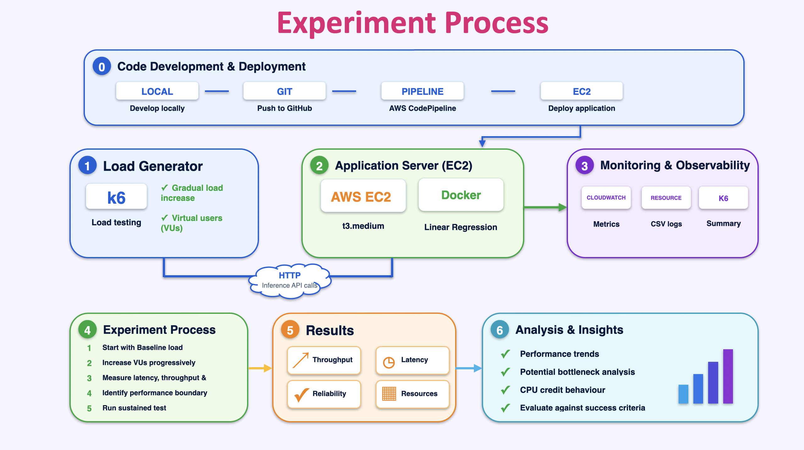

# Machine Learning Model Deployment & Concurrency Testing on AWS

The objective of this project is to develop and deploy a Machine Learning 
inference application on AWS and evaluate its performance, scalability, 
and reliability under varying levels of concurrent traffic. Using a simple Linear Regression model, the project focuses primarily on 
production deployment, containerization, concurrency management, load testing, 
infrastructure monitoring, and horizontal scaling. 

Through controlled experiments, the goal is to identify performance 
bottlenecks, understand infrastructure limitations, 
evaluate scaling strategies, and analyze the associated AWS operational 
costs.

Watch complete results breakdown on [youtube](https://www.youtube.com/watch?v=onX_M8vYrHY).

## Architecture

## Phase 1: Machine Learning Model Development

**Objective:** Develop and serialize a baseline Machine Learning model for inference deployment.

- **Algorithm:** Linear Regression (Scikit-learn)
- **Input Feature:** Area (house size)
- **Target Variable:** Price
- **Train-Test Split:** 80:20
- **Random State:** 42
- **Model Serialization:** Joblib (`.joblib`)

**Status:** Completed

## Phase 2: Frontend & Backend Development

**Objective:** Develop a functional prediction application with frontend-to-backend integration.

- **Frontend:** React, HTML and CSS
- **Backend:** FastAPI
- **Communication:** HTTP/REST API with JSON payloads
- **Integration:** Connected the React frontend to the FastAPI inference service.
- **Validation:** Successfully tested the end-to-end prediction workflow in the local development environment.

**Status:** Completed

## Phase 3: AWS Infrastructure & Production Deployment

**Objective:** Deploy the application to AWS and establish a baseline infrastructure configuration.

Planned activities:
- Provision AWS EC2 infrastructure.
- Containerize the application using Docker.
- Deploy the FastAPI inference service.
- Configure networking, security groups and application access.
- Establish application and infrastructure monitoring using CloudWatch.

**Status:** Completed

## Phase 4: Concurrency & Performance Experiments

**Objective:** Evaluate application performance under varying levels of concurrent traffic.

Planned activities:
- Configure load testing using Grafana k6.
- Simulate concurrent API requests.
- Measure throughput, response latency and error rates.
- Monitor CPU and memory utilization.
- Identify application and infrastructure bottlenecks.

**Status:**  Completed

## Phase 5: Performance Analysis & Cost Optimization

**Objective:** Analyze experimental results and evaluate infrastructure efficiency.

Planned activities:
- Compare performance across deployment configurations.
- Analyze throughput, latency and infrastructure utilization.
- Identify performance bottlenecks and scalability limitations.
- Evaluate AWS infrastructure costs.
- Document findings and present experimental results.

**Status:** Completed

# Trade-offs and Design Decisions

### 1. Streamlit vs. React vs. HTML/CSS

The primary objective of this project is to evaluate backend performance and identify infrastructure limitations. With this in mind, React was not selected because it introduces an additional frontend framework, build tooling, and dependencies that are unnecessary for a simple, single-input prediction interface.

Similarly, Streamlit was not chosen because its application runtime introduces additional resource overhead, potentially increasing CPU and memory consumption and impacting overall application performance.

Instead, **HTML/CSS was chosen as a lightweight alternative** to minimize frontend complexity and resource consumption. This allows the study to focus primarily on backend performance and infrastructure constraints without introducing unnecessary frontend overhead.

### 2. EC2 vs. ECR for Deployment

For deployment, I opted for a simpler approach:

**GitHub → EC2 → Docker Build → Docker Run**

Rather than building a Docker image locally and pushing it to Amazon Elastic Container Registry (ECR), the application code will be pulled directly from GitHub onto the EC2 instance, where the Docker image will be built and executed.

Although ECR provides benefits such as centralized image storage, versioning, and easier image distribution across multiple environments, it introduces an additional service and deployment step.

Given the scope of this project, deploying directly on EC2 offers a simpler workflow with fewer dependencies and less infrastructure overhead, while remaining sufficient for evaluating application performance and infrastructure limitations.

# Results

## Test Setup

| Item | Details |
|------|---------|
| Application | FastAPI inference service (Linear Regression, Joblib) running in Docker |
| Infrastructure | Single AWS EC2 T3.medium instance (Unlimited CPU credit mode) |
| Load testing tool | Grafana k6 |
| Monitoring | Amazon CloudWatch and host/container resource metrics |
| Method | Start at 1 VU, then double the virtual users (VUs) at each stage |

### Acceptance Criteria

A configuration was considered passing only if all of the following held:

| Metric | Threshold |
|--------|-----------|
| p95 latency | ≤ 200 ms |
| p99 latency | ≤ 500 ms |
| HTTP failure rate | ≤ 1% |
| Application checks passing | ≥ 99% |

## 1. Baseline (1 VU)

| Metric | Result |
|--------|--------|
| Requests | ~60 over 60 seconds (~1 request per second) |
| Average response time | 2.7 ms |
| p95 latency | 3.61 ms |
| p99 latency | 4.34 ms |
| Failures | 0 (all requests successful) |

## 2. Throughput Scaling

| Virtual Users | Throughput (req/s) |
|---------------|--------------------|
| 32 | 31.8 |
| 64 | 63.5 |
| 128 | 126.8 |
| 256 | ~250 |
| 512 | ~495 |
| 640 | ~614 |
| 664 to 671 | ~633 to 643 (fluctuating) |

Throughput scaled almost proportionally with concurrency at first. Beyond roughly 512 VUs the gains became less proportional, which suggests the application was approaching a performance boundary for this workload.

## 3. Latency and Performance Boundary

| Virtual Users | Result |
|---------------|--------|
| 671 | p95 165.20 ms, p99 497.43 ms. Passed, but p99 was very close to the 500 ms limit |
| 672 | p99 rose to 517.55 ms, crossing the acceptance limit |
| 704 | Both p95 and p99 exceeded their thresholds |
| 768 | Also failed the p99 criterion |
| 1,024 | Throughput dropped to ~47 req/s and p95 latency rose to ~34.7 s |

Increasing concurrency indefinitely does not keep increasing throughput. Past a certain point, performance degrades substantially.

## 4. Infrastructure Resource Utilization

| Resource | Observation |
|----------|-------------|
| Host CPU | Maximum ~51% during the 671 VU discovery run |
| Container CPU | ~92% during the 671 VU discovery run; above 100% in some higher-load runs (possible because a process can use more than one logical CPU) |
| Memory | Stable, with ~3 GB of host memory available on average and container memory around 3.3% |
| CPU credits | Balance decreased under higher load and recovered later. Surplus credit balance and surplus credits charged stayed at zero |

No significant memory pressure and no CPU-credit exhaustion were observed. These metrics describe resource usage, but they do not independently establish CPU as the definitive bottleneck.

## 5. Sustained-Load Confirmation (10 minutes at 671 VUs)

| Metric | Result |
|--------|--------|
| Total requests | 392,560 |
| Average throughput | ~653 req/s |
| HTTP failures | 0 |
| Application checks | All passed |
| p95 latency | ~101.16 ms |
| p99 latency | 162.15 ms |

Both latency percentiles stayed comfortably within the acceptance criteria. The sustained run showed lower p95 and p99 than the earlier 671 VU discovery run, which highlights the variability between individual experiments.

# Conclusions

## Key Findings

1. **Measured boundary:** 671 VUs is the highest passing configuration identified in these experiments.
2. **Sustained capacity:** at 671 VUs the application handled ~653 requests per second for 10 minutes with zero observed HTTP failures and latency within the limits.
3. **Tail latency fails first:** p99 crossed its threshold at 672 VUs, before throughput stopped growing.
4. **Hard degradation:** at 1,024 VUs throughput collapsed to ~47 req/s and p95 latency reached ~34.7 s.
5. **Resource profile:** CPU was the most heavily used resource, while memory stayed low and CPU credits were not exhausted.

## Interpretation

Throughput first grew almost in proportion to concurrency, then flattened, and tail latency eventually crossed the acceptance thresholds. The result is a measured performance boundary for this specific application, instance type, request pattern and set of acceptance criteria. It is not the absolute maximum capacity of the EC2 instance.

## Limitations

- Results come from a single EC2 T3.medium instance and a single request pattern.
- The sustained confirmation was one 10-minute run. Repeated runs are needed before treating 671 VUs as a stable performance guarantee.
- Resource metrics do not prove CPU is the bottleneck.
- Horizontal scaling and AWS cost analysis (Phase 5 objectives) are not covered by these results yet.

## Future Work

- Scale toward 1 million requests per second
- Horizontal scaling with a load balancer and auto scaling
- Compute-optimised (non-burstable) instances and per-instance tuning (workers, batching, caching)
- Distributed k6 load generation
- Spike, soak and stress testing
- Heavier models and GPU inference
- Prometheus and Grafana monitoring
- Cost per million requests
